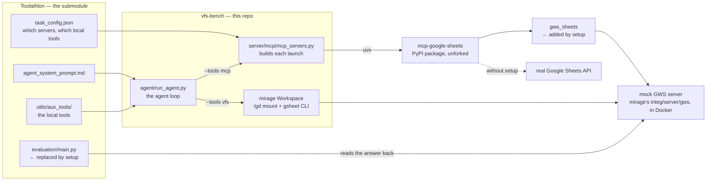

# Toolathlon setup

`submodule/Toolathlon/` is a submodule holding upstream's benchmark, unmodified. It
assumes real Google accounts, real credentials, and a deployment layout this
machine does not have. `setup/toolathlon/setup_toolathlon.py` patches exactly those
points, so the checkout runs against the local fakes instead.

Run it once after cloning -- `setup/setup.py` runs it first, before
anything that needs the fakes. Every step checks whether it already ran, so
running it again is safe.

It also builds a second virtualenv, `submodule/Toolathlon/.venv`. Two on
purpose: Toolathlon pins `openai-agents==0.0.15` and this repo needs
`>=0.18`, so `./.venv` drives the benchmark and that one drives the
evaluator.

```bash
uv run python setup/toolathlon/setup_toolathlon.py
```

## What it is for

A concrete case: running `nhl-b2b-analysis` on the MCP arm. Its
`task_config.json` declares the `google_sheet` server, so the run launches
upstream's Sheets server. On a fresh checkout that server never starts:

```
ModuleNotFoundError: No module named 'mcp.server.fastmcp'
```

Upstream launches it like this:

```yaml
params:
  command: uvx
  args:
    - "mcp-google-sheets"
  env:
    CREDENTIALS_PATH: "${token.google_oauth2_credentials_path}"
    TOKEN_PATH: "${token.google_oauth2_token_path}"
    DRIVE_FOLDER_ID: "${token.google_sheets_folder_id}"
```

`uvx` resolves the newest `mcp`, and `mcp>=2` moved `FastMCP` — hence the
traceback. And had it started, those three `${token.*}` values would have
authenticated it to a real Google account, not to the fixture holding this
task's 1,313-row schedule.

The script fixes both in that one file, with five lines:

```diff
   args:
+    - "--with"
+    - "mcp>=1.2,<2"
     - "mcp-google-sheets"
   env:
     ...
+    PYTHONPATH: "<repo>/redirect/gws_sheets"
+    GWS_MOCK_URL: "http://127.0.0.1:19999"
+    SERVICE_ACCOUNT_PATH: "/nonexistent.json"
```

The pin makes it start. `PYTHONPATH` puts a `sitecustomize.py` ahead of the
server's own code, wrapping `googleapiclient.discovery.build` so
`build("sheets", "v4")` resolves to the mock. The package itself is
untouched: same `uvx mcp-google-sheets`, same 20 tools, same schemas.

Where that sits in the chain — this repo drives the loop, Toolathlon
supplies the task and the tools, and mirage supplies the fake that both arms
end up talking to:



Only two links in that graph are this script's doing, and both are marked:
the shim that bends the unforked package away from `REAL`, and the evaluator
that reads the answer back out of the fake instead of out of Google. Every
other edge is upstream's.

After that, the same run reaches the fixture and is graded against it:

```
mcp servers=3 tools=50 {'google_sheet': 20, 'filesystem': 14, 'terminal': 2, 'local': 14}
All data match!
eval_exit=0
```

## What it changes

Six files edited:

1. **`configs/mcp_servers/google_sheet.yaml`** — pin `mcp<2`, add the
   mock-GWS shim. The example above.
2. **`configs/mcp_servers/terminal.yaml`** — pin `mcp<2`, and nothing else.
   Without it the server will not start.
3. **`configs/mcp_servers/yahoo-finance.yaml`** — replace the command.
   Upstream resolves it under `${local_servers_paths}/`, which does not
   exist here, so the server fails silently — and `oil-price`'s evaluator
   catches the failure and reports success without checking anything.
4. **`configs/mcp_servers/google_calendar.yaml`** — run the vendored server
   through `redirect/gws_calendar/calendar_hook.mjs`, aimed at the mock.
5. **`tasks/finalpool/nhl-b2b-analysis/preprocess/main.py`** — upstream
   builds the fixture by copying a live public spreadsheet out of Google
   Drive. Ours calls `shared/seed_mock.py`, the seeder both arms already use.
6. **`tasks/finalpool/nhl-b2b-analysis/evaluation/main.py`** — upstream reads
   the answer back with `gspread` against real Google. Ours reads the same
   spreadsheet from the mock over HTTP: same checks, same order, and
   upstream's own `normalize_str` for the cell comparison.

Those last two are not written here. They are copied in from
[`task/toolathlon/nhl-b2b-analysis/toolathlon/overrides/`](../../task/toolathlon/nhl-b2b-analysis/toolathlon/overrides),
where they live under version control as `preprocess_main.py` and
`evaluation_main.py` — the task's replacements for upstream's files, kept
with the task they belong to rather than in this script. A replacement is
the last resort: nine other tasks bend upstream's evaluator with a
`sitecustomize.py` instead and leave its code alone. See
[`task/toolathlon/README.md`](../../task/toolathlon/README.md) for when each
is used.

Three files created, all gitignored inside the submodule:

7. **`configs/global_configs.py`** and **`configs/token_key_session.py`** —
   from upstream's `*_example.py` templates, with the OAuth paths pointed at
   a fake token.
8. **`configs/google_credentials.json`** — that fake token, at the literal
   path several evaluators read directly rather than through
   `token_key_session`.

Nothing is backed up beside the originals. Both overwritten files are
tracked by the submodule, so `git -C submodule/Toolathlon diff` shows
exactly what this changed and `git checkout` puts it back — which a `.bak`
next to the file only imitated, and imitated badly, since a second run
overwrote the backup with the already-patched copy.

## What it does not change

No server code, no tool definitions, no descriptions, no schemas. Everything
the model is shown stays upstream's — which is the point, since the MCP arm's
cost is made of those schemas.

Two things follow from that:

- The submodule is permanently dirty. `.gitmodules` sets `ignore = dirty`;
  never run `git submodule update --force`, which discards these edits
  without a word.
- These rewrites serve Toolathlon's own runner and its evaluators, not this
  repo's MCP arm. That arm builds its own launch parameters in
  `server/mcp/mcp_servers.py`, and reads upstream's yaml out of the pinned
  commit (`git show HEAD:`) rather than off disk, so an edit here cannot
  reach a measured number.
- The lineage does not follow the rewrite either. Before patching anything,
  this script copies the four configs' committed text into
  [`upstream/`](upstream), and `dvc.yaml` depends on those copies -- hashing
  the rewritten files recorded the directory the checkout happened to live
  in, so `dvc.lock` matched in exactly one checkout at a time and the
  `fixture-lineage` hook rejected every commit made in any other. The four
  are in `.dvcignore` for the same reason: `nvidia-lineage` depends on the
  whole `configs/mcp_servers` directory.

## Original paper and Forms servers

After the usual setup, run:

```sh
uv run python -m server.mcp.setup_papers_forms
```

The installer restores the arXiv LaTeX, Scholarly and Google Forms repositories
at the original Toolathlon Dockerfile's commits, then installs their complete
committed dependency locks. The arxiv-local environment derives its dependency
versions and unchanged retry wrapper from Toolathlon's pinned tree. These
sources live under `vendor/`; the Gym forks are not used for these tools.
`source.json` receipts and DVC stages track the source commits, manifests,
locks and wrapper. Both the MCP launchers and CLI workers check source integrity.

The [five task READMEs](../../task/toolathlon/README.md#paper-forms-and-canvas-conversions)
cover local paper execution, the existing E2B service setup and validation.
