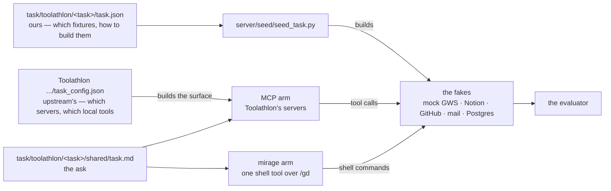

# Tasks

One directory per task, under one directory per dataset:
`task/<dataset>/<task>/`. Everything a draw needs is inside it — the ask,
the fixture, both arms' configs, and the manifest that builds them. What a
run *leaves behind* is deliberately not: its transcript goes to `dumps/`
and its scratch to `state/workspaces/<run_id>/`, both at the repository root,
because the agent's own working directory used to be a child of the task
directory and `ls ..` reached every previous run.

```bash
uv run python server/seed/seed_task.py nhl-b2b-analysis
```

Both arms run against the same live services one after the other, so this
runs before every measured draw -- `agent/run_agent.py` calls it, with no
way to ask it not to, and `bin/start.sh task <task>` calls it too.

## What it is for

A task is two declarations and a fixture. This directory holds the half that
had to be written: **what to build before an arm runs, and how**. The other
half — which tools the arm gets — is upstream's, and is read from upstream's
own file, never restated here.

Take `nhl-b2b-analysis`. Its whole manifest,
[`toolathlon/nhl-b2b-analysis/task.json`](toolathlon/nhl-b2b-analysis/task.json),
is nine lines:

```json
{
  "id": "toolathlon_nhl-b2b-analysis",
  "fixtures": [
    { "id": "drive/nhl-schedule", "kind": "script",
      "run": "shared/seed_mock.py", "with": ["openpyxl"] }
  ]
}
```

`seed_task.py` reads it, looks `script` up in its `KINDS` registry, and runs
the task's own seeder — which loads 1,313 rows of schedule into the mock
Drive as `NHL 2425 Schedule`. That is the state both arms then start from.

Upstream cannot do this part. Its preprocess builds the same fixture by
copying a live public spreadsheet out of Google Drive with real credentials,
so there is nothing to point at a fake. That gap is the only reason the
manifest exists.

## The two declarations, and who reads which



The manifest is **arm-agnostic** — nothing in it mentions MCP or mirage,
because the fixture is the one thing the two arms must not differ on. What
differs is only how each reaches it: the MCP arm through
`google_sheet_get_sheet_data`, the mirage arm through `cat /gd/….gsheet.json`.
Same bytes, same process, two paths.

## What is in a task directory

```
task/toolathlon/<task>/
  task.json      the fixture manifest — 29 of 46 tasks have one; the rest
                 need only their workspace copied
  shared/        the fixture itself: task.md, CSVs, ground truth, seeders
  vfs/           the mirage arm: workspace.yaml, VFS.md, SKILL.md
  toolathlon/    the two ways upstream's own preprocess and evaluation are
                 bent to reach a fake -- a sitecustomize that redirects the
                 client (10 tasks), or a file that replaces upstream's
                 outright (1). See task/toolathlon/README.md
  tests/         parity cases, run by tests/parity.py
  README.md      what this task measures and what happened
```

A manifest's `run` is relative to its own directory (`shared/seed_mock.py`),
which is what lets the whole thing move as one unit.

## What is shared

Two entries are not tasks, and sort first because of the underscore.

- **`script/`** — what *derives* a committed fixture or *reads* a finished
  run, and nothing that seeds. `derive_task_md.py` is a dvc stage;
  `capture_web.py` freezes a live source's responses behind a frozen
  stage, run by hand and rarely, and derives the committed rows from them;
  `grade_task.py` runs upstream's evaluator; `setup_wheels.py` and
  `setup_pyodide_packages.py` fetch what the mirage arm mounts.

- **`shared/`** — the few fixtures and templates more than one task reads: a
  Notion page template, a Snowflake MCP entry point, and one yfinance
  skills page.

The seeders are **not** here. They are in
[`server/seed/`](../server/seed/), next to the fakes they fill, and they
reach a task only through the dataset seam -- which is what stopped a second
dataset meaning an edit to the seeder. `seed_task.py` reads a manifest and
dispatches each entry by `kind`:

```python
KINDS = {"mail": seed_mail, "bigquery": seed_bigquery,
         "storage": seed_storage, "logging": seed_logging,
         "script": seed_script}
```

Across all 91 manifests: **25 `script`, 12 `mail`, 7 `bigquery`,
3 `logging`, 3 `storage`.** No kind takes an option. There is no `market`
kind any more: every Yahoo task reads the live service, as upstream does.

`script/` and `shared/` are per-dataset on purpose: a second benchmark
brings its own, because how a fixture gets built is exactly what two
benchmarks do not share.

## What is not here

The fakes live in [`server/clients/`](../server/clients/README.md), what makes upstream's
processes reach
them lives in [`redirect/`](../redirect/README.md), and the CLIs the mirage
arm mounts live in [`cli/`](../cli/). None of the three is a task fixture: a
fake belongs to the service it stands in for, a redirect to the name it
claims, and a CLI to the surface it is part of. Only the per-task shims that
patch upstream's own evaluator stay with the task, in
`<task>/toolathlon/eval_shim/`, because what they patch is per-task.
