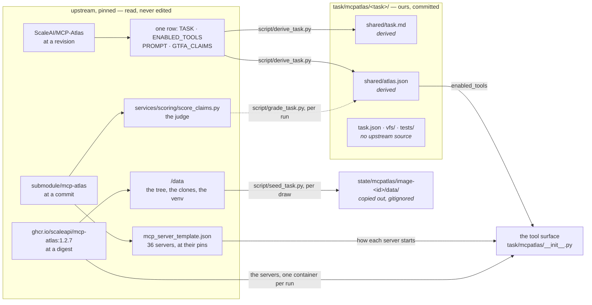

# MCP-Atlas tasks

Tasks drawn from [MCP-Atlas](https://github.com/scaleapi/mcp-atlas), one
directory each. This page is about **what the directories mean and where
their contents come from**. For what a task directory *is*, see
[`task/README.md`](../README.md); for the other dataset, see
[`task/toolathlon/README.md`](../toolathlon/README.md).

Results are published on the [VFS-Bench 1.0 leaderboard](https://agentvfs.org/benchmark/vfs-bench-1).

## The dataset is in two places, so a task's provenance is too

Toolathlon ships a task as a directory in a repository, and one pinned
submodule is the whole of its authority. MCP-Atlas splits it: the
**environment** is a sandbox image built from the repository, and the **500
task rows** — the ask, the tool list, the graded claims — live on the Hub as
one parquet.

Both halves are pinned; only one is committed here. There is exactly one
environment and all 500 tasks share it: `ghcr.io/scaleapi/mcp-atlas:1.2.7`,
whose `/data` is the repository's `services/agent-environment/data`, the
eight repositories its Dockerfile clones into `repos/`, and the venv it syncs
for the code executor. So it is not a per-task fixture and is not stored as
one. The MCP arm's servers run in that image, one container per run, and read
its own `/data`; `script/seed_task.py` copies the same `/data` out of the same
image into `state/` for the mirage arm to mount. The image digest is its
entire lineage, and nothing here could drift from it. The Hub is not a
checkout, so the rows *are* committed, and [`dvc.yaml`](../../dvc.yaml) is
what traces them.

Both files under `shared/` are outputs of a script, and `dvc status` names
them when the revision moves: `atlas.json` is upstream's row and nothing else,
claims included, and upstream's own scorer grades a run against it.

`shared/data/` is absent for a different reason. It would not be a *derived*
file but a *duplicated* one — the same bytes as the pinned image, in a second
place, needing a stage to keep them honest. Deleting the copy deletes the
drift.

    uv run dvc status                 what has drifted from its source
    uv run dvc repro                  rebuild whatever drifted

## Where each pin lives

| pinned | where the pin is written | what moves if it changes |
|---|---|---|
| the image | `IMAGE` in `__init__.py`, and `FROM` in `docker/mcpatlas.Dockerfile` | `/data` on both arms -- the tree, the clones at their commits and refs, the code executor's venv -- and every server the image carries, which is the tool schemas, the denominator of every saving |
| the four servers upstream fetches from a branch | each one's lock under `vendor/mcpatlas-mcp/`, installed by `docker/mcpatlas.Dockerfile` | github's, weather's, weather-data's and pubmed's tools |
| how each server starts | `mcp_server_template.json` at the `submodule/mcp-atlas` gitlink | its arguments and environment |
| the grader | `services/scoring/score_claims.py` and `requirements.txt` at the `submodule/mcp-atlas` gitlink; the judge, `JUDGE` in `script/grade_task.py` | every grade |
| the dataset revision | `REVISION` in `script/derive_task.py` | `shared/task.md`, `shared/atlas.json` |
| the exports | `data_exports/` in the checkout, and `integ/truth/notion_atlas.json`, `integ/truth/slack_atlas.json` and `integ/truth/airtable_atlas.json` at the `submodule/mirage` gitlink | the Notion and Slack workspaces and the Airtable base, written by `server/seed/atlas_exports.py` into `state/mcpatlas/<pin>/fakes-<mirage pin>-<builder digest>/`; Slack's and Airtable's are mirage's files as they stand, Airtable's captured from the share link Atlas publishes in place of an export |

dvc cannot depend on a URL, so the Hub revision is a constant in the script
and the *script* is the dependency. Bumping it still shows up as drift.

## What this dataset does not have

Worth saying, because each absence is why the seam has a flag for it.

- **No stack.** An Atlas fixture is its image's `/data`, and, for a task
  that enables Notion, Slack or Airtable, the workspace or base Atlas has a
  user import from its export or copy from its share link. None is a shared
  service, so `NEEDS_STACK = False`. Each run
  starts its own container of the image (`uv run python
  server/mcp/setup_mcpatlas.py` builds it, once), the mirage arm reads its
  own copy of `/data`, and the services are mirage's fakes, one process
  each per run, seeded by `server/seed/atlas_exports.py` --
  so there is no previous arm's state to reset. What `script/seed_task.py`
  builds is the tree itself, not a reset of one.
- **No per-task fixture.** One image, one `/data`, 500 tasks. A tree cut down
  to the files a task happens to need would also be a `list_directory /data`
  upstream never showed the model, so the seeder takes the whole of it and
  filters nothing.
- **No local tools.** Toolathlon hands a task an in-process `python_execute`;
  Atlas reaches even Python over MCP, through `mcp-code-executor`. So
  `needed_local_tools` is always empty and the seam declares no `LOCAL_TOOLS`.
- **No agent framework.** Toolathlon is built on `openai-agents` and pins it,
  so the agents runner is its harness shape. Atlas's harness is a TypeScript
  service, `services/agent-harness`: a hand-written loop that asks the model
  over Chat Completions and reaches every tool through one HTTP app,
  `services/agent-environment`. Both are run as they are
  (`agent/atlas/`), so `LOOP = "atlas"`, and both arms of a draw run
  on them. The mirage arm's app serves one server, the shell, so fastmcp adds
  no prefix and the model sees `shell`. It answers with what the command
  printed, and a command that exits non-zero ends with the line upstream's
  own shell server, `cli-mcp-server`, ends every reply with:
  `Command completed with return code: N`. Without it, a failure that
  printed nothing, like a `grep` with no match, reached the model as the
  harness's `success` (`sandbox-client.ts:263`). The harness posts to a
  LiteLLM proxy, so a Gemini model is asked through LiteLLM's Gemini adapter here too, which
  is what turns the empty enum values Oxylabs' tools declare into ones Gemini
  accepts.
- **No system prompt.** `run_eval.py` sends the task alone, and the harness
  prepends an empty system message only for `openai/gpt-5`
  (`litellm-strategy.ts:134`), so `PROMPT` is `None` and the MCP arm is given
  no system message at all. The mirage arm's system message is its `VFS.md`
  and `SKILL.md`, which describe what the MCP arm learns from its tool
  descriptions. One paragraph of `VFS.md` is advice with no counterpart
  there: output comes back whole and some files are large, so a search goes
  at a directory or file rather than a whole mount. A table's `rows.jsonl`
  is said to run to megabytes for the same reason.
- **No evaluator.** Atlas scores the final message against the row's claims
  with an LLM judge, and `script/grade_task.py` runs that scorer: upstream's
  module, in an environment built from upstream's requirements, asking
  upstream's default judge through this repo's gateway. A run passes at 0.75
  coverage, the pass rate upstream leads with. A judge need not answer the
  same twice, so each verdict is written into the run's dump.
- **No server list.** Atlas never names servers; a row names *tools*, and the
  sandbox composes every server into one client. The server set is derived
  from the tool list, and the tool list is what the arm is built from —
  hand-picked, so a task gets ten of the filesystem server's fourteen tools
  rather than all of them.
- **A mount only where the tools read it.** A mount holds the whole of its
  service, where the MCP arm reaches only what the row's tools read, and a
  mount beyond them is a way to the answer that arm never had. So a task
  mounts Notion, Slack, Airtable, MongoDB or Calendar only when it enables
  tools that find and read what the mount shows (`MOUNT_READERS`): Notion
  needs `post-search` and `get-block-children`, whose page bodies `page.json`
  holds. Otherwise the mirage arm reaches the service through the MCP arm's
  own tools alone, its tool-command CLI. `/data` is mounted whole only where
  a tool reads files there; where git is its only reader, the mirage arm gets
  the eight repositories and nothing beside them; otherwise it gets none of
  it. Three differences remain, because no mount can leave them out: a Slack
  mount holds file contents and user profiles no Slack tool Atlas enables
  returns, an Airtable mount holds every record where `list_records` returns
  the first 100, and `git` stays native, so on a task that enables only
  git's status or diffs it reads more of a repository than they return.

## What is shared

- **`script/`** — three entry points, each self-selecting this dataset from
  its own path rather than inheriting a caller's: `derive_task.py` rebuilds
  the committed half above, `seed_task.py` copies the other half out of the
  image before each arm, and `grade_task.py` scores a run's dump.

The scripts are per-dataset rather than global for the reason
[`task/README.md`](../README.md) gives about Toolathlon's: how a fixture is
built is exactly what two benchmarks do not share.
