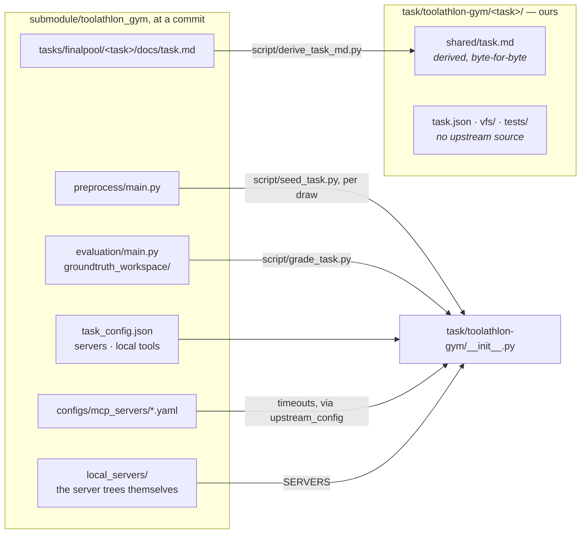

# Toolathlon-GYM tasks

Tasks drawn from [Toolathlon-GYM](https://github.com/eigent-ai/toolathlon_gym),
one directory each. This page is about **what the directories mean and where
their contents come from**. For what a task directory *is*, see
[`task/README.md`](../README.md); for the other two datasets, see
[`task/toolathlon/README.md`](../toolathlon/README.md) and
[`task/mcpatlas/README.md`](../mcpatlas/README.md).

## It is Toolathlon's format, which is why this seam is short

GYM is built on Toolathlon and says so: same task directory shape, same
`task_config.json`, same evaluator contract, same MCP server interfaces. What
differs is scale and backing — **503 tasks against 109, disjoint from them,
served by one local Postgres rather than a spread of accounts**.

So `task/toolathlon-gym/__init__.py` is `task/toolathlon/__init__.py` with the
checkout swapped, and every line that is *not* a swap is a place the two
genuinely differ. Those lines are the file worth reading.

One derived file, because there is almost nothing to derive: a GYM task
states its setup as a script this repo *runs* rather than as data this repo
copies, so the gitlink is the whole of the fixture's lineage and there is
nothing here that could drift from it. The ask is the exception, and it has a
stage in [`dvc.yaml`](../../dvc.yaml) — bump the gitlink and `dvc status`
names every ask whose text moved.

## Where the servers come from, which is not where Toolathlon's do

GYM **vendors** its MCP servers under `local_servers/` where Toolathlon
resolves them through `npx -y` and `uvx --from` at run time. That makes the
gitlink a stronger pin than Toolathlon's config can be, and it is why this
dataset's four builders are three lines each.

It also means the two datasets do not always run the same server:

| server | Toolathlon here | GYM here |
|---|---|---|
| `filesystem` | GYM's vendored `dist/index.js` | the same tree |
| `excel` | GYM's vendored `excel-mcp-server` | the same tree |
| `pptx` | GYM's vendored `Office-PowerPoint-MCP-Server` | the same tree |
| `howtocook` | npm `howtocook-mcp@0.2.2` | **vendored 0.1.1** |

Three of the four were already GYM's: Toolathlon's own configs reach into
`${local_servers_paths}` and this repo followed them there, so `Launch.
vendored` has pointed at this checkout all along. `howtocook` is the one that
differs, and it differs in both directions that matter — a different tool
surface and a different recipe corpus — which is the whole reason a dataset
carries its own `SERVERS` registry rather than borrowing the shared one.

Two things about that server are worth knowing before trusting a number from
it:

- **Its `build/` is gitignored upstream**, and the one file committed there
  is a stale partial that imports four directories which are not beside it.
  `setup/setup.py` runs `npm install && npm run build` over the tree, which is
  what GYM's own Dockerfile does.
- **It reaches the internet unless stopped.** `fetchRecipes`
  (`src/data/recipes.ts:10`) requests `https://weilei.site/all_recipes.json`
  and falls back to the committed corpus only when that fails. On a machine
  with network the MCP arm would read whatever that site serves today while
  the mirage arm read the file in the tree — and the same arm would read
  something different next week. The builder starts it behind
  `NO_NETWORK`, so the fallback is the answer and the answer is the corpus
  the gitlink pins. The server says so on startup:
  `获取远程菜谱数据失败，将使用本地备份数据`.

## The harness is CAMEL, and this repo does not run it

The one divergence, declared rather than hidden. GYM drives a
`camel.agents.ChatAgent` (`utils/roles/task_agent.py`); this repo runs the
`openai-agents` loop on its tasks, which is `LOOP = "agents"` on the seam.
Four consequences, all of which change what the model is sent:

1. **Tool schemas.** `_sanitize_tool_schemas` rewrites every definition
   before it goes out — strips `strict` and `additionalProperties: false`,
   drops `enum` from non-string fields, gives untyped array items a
   `type: string`. The agents runner sends what the server declared.
2. **Tool results**, capped at 8,000 chars there, at
   `MAX_SINGLE_TURN_RETURN_CHARS` here.
3. **The system prompt**, which CAMEL appends a `claim_done` sentence to and
   then rewrites `local-claim_done` to `claim_done` in.
4. **The local tools**, below, which is the expensive one.

Closing it means running CAMEL's loop on `camel-ai` at GYM's own pin, the
way [`agent/atlas/`](../../agent/atlas/) runs MCP-Atlas's.

### The local tools are eight tools too many, in our favour

GYM's `_build_local_tools` resolves this task's five declared names to **six**
tools: `claim_done`, `python_execute`, the two overlong helpers, and one stub
apiece for `manage_context` and `history` — CAMEL manages its own memory, so
those two are `async def(action="") -> "OK"`. Toolathlon's
`local_tool_mappings` resolves the same five names to **fourteen**, because
its `manage_context` is three tools and its `history` five, all real.

Local tools go to the MCP arm only; the mirage arm has a shell. So running
Toolathlon's harness hands the arm this repo measures *against* eight tools
GYM never shows it — which inflates the denominator, which is to say it
flatters this repo's own number. It is declared rather than quietly corrected
because the harness was chosen whole, and a hand-picked subset of a harness
is not a harness.

## What is shared

- **`script/`** — three entry points, each self-selecting this dataset from
  its own path rather than inheriting a caller's: `derive_task_md.py` copies
  the ask, `seed_task.py` empties the workspace and runs the task's own
  `preprocess/main.py`, and `grade_task.py` runs its own `evaluation/main.py`.

`seed_task.py` runs upstream's setup in a subprocess rather than importing
it, which is the case this repo allows: the callee is upstream's code, run as
a module against upstream's interpreter and upstream's dependency set.

## Which tasks can be added

167 of the 503 declare only servers this repo already builds. The rest are
blocked by one of ten: `woocommerce` (104 tasks), `canvas` (92),
`playwright_with_chunk` (63), `google_forms` (60), `scholarly` (37),
`arxiv_local` (34), `youtube` (21), `rail_12306` (17), `arxiv-latex` (14),
`youtube-transcript` (4).

Of the 167, six need no running service at all — all six use `howtocook` —
and the rest want Postgres, mail or a Notion fake. `needs_stack` on the seam
is derived from the task's own declaration rather than set for the dataset,
so a task that reads four files does not ask for Docker.
