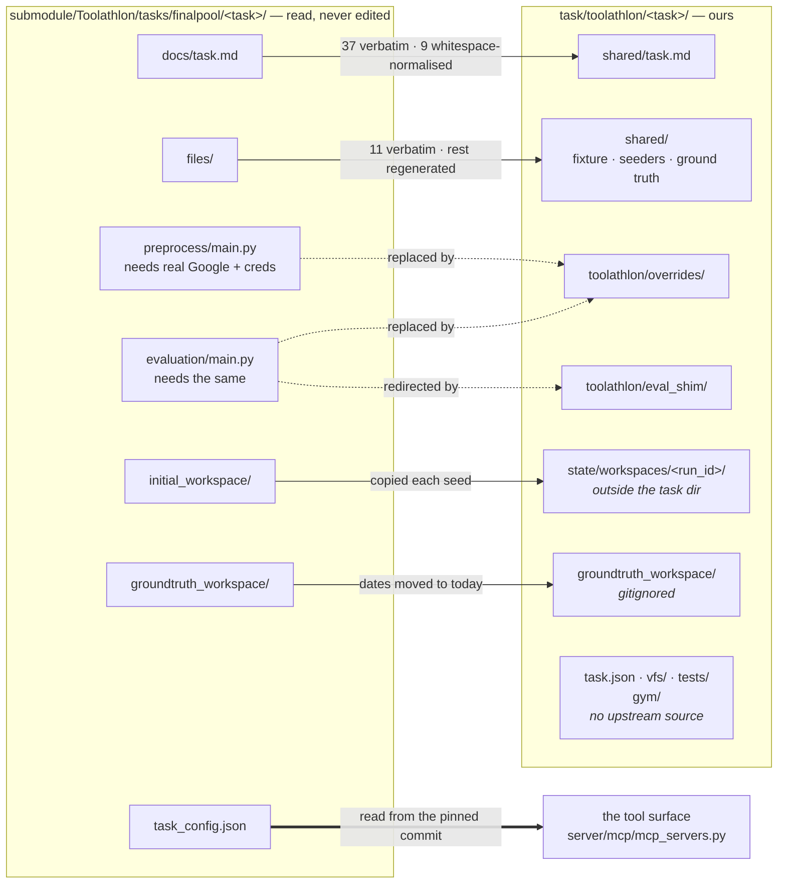

# Toolathlon tasks

Tasks drawn from [Toolathlon](https://github.com/hkust-nlp/Toolathlon),
one directory each. This page records their **conversions and data
lineage**. For what a task directory *is* — the manifest,
the two declarations, who reads which — see [`task/README.md`](../README.md);
for how a task is set up to run, see
[`setup/toolathlon/README.md`](../../setup/toolathlon/README.md).

Results are published on the [VFS-Bench 1.0 leaderboard](https://agentvfs.org/benchmark/vfs-bench-1).

## Kept tasks

Toolathlon is measured on 100 of the 108 original tasks. These eight were
cut, and their directories removed:

| Task | Why it was cut |
|---|---|
| `canvas-list-test` | The grader needs course credits the seeder never gives either arm. |
| `task-tracker` | The reference expects `client-portal` marked "implementing" though it is complete; no run has passed, upstream's included. |
| `university-course-selection` | The reference leaves out a cohort the timetable lists; every run fails on that cell, upstream's too. |
| `merge-hf-datasets` | The reference keeps type strings like `List[int]` where the task asks for normalized types. |
| `ipad-edu-price` | Live: the grader's US price, USD 905, is the page's trade-in credit, not a price. |
| `language-school` | Live: the task asks for this year's admissions data, but the reference is fixed. |
| `mrbeast-analysis` | Live: the YouTube durations no longer match the reference. |
| `yahoo-analysis` | The grader counts every row of `yfinance`'s rating history, which only the MCP arm's Python has (41 rows against 305). |

Their READMEs are gone from this checkout, so each row links to its
README at [`d0cd08a3`](https://github.com/agentvfs/vfs-bench/tree/d0cd08a35deca852cf7ec0d66ebd15bbafc1bc22),
the last commit to hold it.

## Implementation notes

The current common output ceiling is not a per-tool size guarantee. For
example, MCP's Sheets tool defaults to values and Canvas's user tool pages
at 20, while the generic shell can display 100,000 characters from a broader
read. Canvas/WooCommerce CLI responses now come from the original handlers,
while their mounts preserve complete directory enumeration. Sheets guidance
uses existing value-range reads. The global output cap and original task
settings are unchanged.

The previous XLSX restoration sent explicit formats for every cell. Text
and Image has 40,202 unstyled empty cells plus 20,407 genuinely styled empty
cells. The seeder now omits formats for the unstyled empty cells and retains
actual source styles and values. An original full
Google grid-response capture is needed before claiming exact API parity or
discarding all blank styled cells. Both arms share the restored API, but
the richer VFS read pays more for that representation.

The service CLI correction has a `service-mcp-tools` DVC stage linking
original configuration and dependency locks to copied tool schemas and
implementation hashes. Both arms verify those records before launch. The
fixture capture stages still reference original source data; XLSX restoration
changes are covered by the existing lineage stages. Task statements, graders
and formal settings remain unchanged; VFS capability guidance was updated.

## Research conversions

Five more original tasks have conversions: `academic-pdf-report`, `add-bibtex`,
`cvpr-research`, `logical-datasets-collection` and `profile-update-online`.
They reuse the local browser, paper tools and disk workspace. The profile
archive is extracted and removed before either agent starts, matching its
original preprocessing.

`web-search web-search` invokes the original Serper local-tool handler with its
original schema. `fetch html`, `fetch txt`, `fetch markdown` and
`fetch json` invoke the locked fetch server's original handlers, including
optional request headers and the original HTML/Markdown transforms. These
CLIs call handlers directly; they do not call an MCP client. Each independent
shell call starts in `/work`, keeping concurrent directory changes isolated.

Search tool responses and raw fetch HTTP responses are cached by exact request
outside the agent workspace, with timestamps and hashes in run provenance.
New requests still use live services; this is not a fully frozen web corpus.
Browser navigation remains live. Fetch excludes private network targets so
it cannot read another task's local fixture services. Credentials are redacted
from the original search handler's exception text and logs on API failures.

Integration probes built both surfaces for the batch, checked search schema
parity, and compared all four fetch schemas and full responses. Initial files,
original graders, archive preprocessing and server dependencies have DVC
lineage. No test files were added.

Install the existing locked service dependencies with:

```sh
uv run python -m server.mcp.setup_papers_forms
npm --prefix vendor/fetch-mcp ci --ignore-scripts
uv run python -m server.mcp.setup_browser
```

Validate sources with `uv run python -m setup.research_lineage` and
`uv run dvc status`.

Use a key from `serper.dev` for `SERPER_API_KEY`; `serpapi.com` is a
separate provider.

## Paper, Forms and Canvas conversions

Five more original tasks have conversions: `canvas-art-manager`,
`latex-prompt-box`, `find-alita-paper`, `woocommerce-customer-survey` and
`woocommerce-product-recall`.

Paper lookup is a CLI operation. The commands keep the original tool names:
`arxiv-local search_papers`, `arxiv-local download_paper`, `scholarly search-arxiv`,
`scholarly search-google-scholar` and `arxiv-latex get-paper-prompt`.
Each accepts one JSON argument object; `--help` exposes the original schema.
Forms follows the same rule, for example `google-forms create_form`. These CLIs
invoke the original handlers directly in their pinned dependency environments.
They do not route commands through an MCP client. Canvas and WooCommerce
retain separate mounts, API clients and CLIs.

After the usual repository setup, install the original paper/Forms sources:

```sh
uv run python -m server.mcp.setup_papers_forms
```

The three service tasks also use the existing
[E2B service setup](inventory-sync/README.md). Their original database,
workspace and mail captures are restored separately for each arm; all measured
sandboxes are deleted after grading. Paper tasks run locally and require no
additional service credentials. Google Forms uses Mirage's isolated API with
fixture OAuth credentials, so these two commerce tasks require no live Google
account. This does not remove the credential requirement of browser-based
`fillout-online-forms`.

Source/hash checks cover the original task text, native service captures,
full foreign server locks and original per-call timeouts. Integration probes
matched all 12 paper/Forms tool schemas, full sampled paper responses,
Forms writes across MCP/CLI and reads through the original grader client.
Private paper caches are inaccessible from the agent workspace. No test
files were added. Check the entire graph, including frozen captures, with:

```sh
uv run python -m setup.papers_forms_lineage
uv run python setup/lineage.py
uv run dvc status
```

Public paper assets and captured queries are frozen with URL, time and hash
receipts. New search queries still reach arXiv/Scholar and record their raw
responses in the shared cache. Identical URLs reuse the same bytes across
arms, including concurrent runs; the search corpus is not fully frozen.

## Browser conversions

[shopping-helper](shopping-helper/README.md),
[nvidia-stock-analysis](nvidia-stock-analysis/README.md) and
[k8s-pr-preview-testing](k8s-pr-preview-testing/README.md) use the original
31-tool Playwright fork. Its separate CLI preserves each tool suffix:
`browser_navigate` becomes `browser navigate`, and
`browser_snapshot_navigate_to_next_span` becomes
`browser snapshot_navigate_to_next_span`. Arguments and responses come from
the original backend; no new browser implementation is substituted.

Shopping and NVIDIA use a local browser container and a local disk mount on both
surfaces. Kubernetes preview runs its browser beside the E2B cluster, with
files shared through SSH and archived to S3. A Git preflight exposed
S3/FUSE pack-file truncation, so preview uses the sandbox's POSIX filesystem.

The [GDP workbook](gdp-cr5-analysis/README.md),
[Job Finder source](notion-find-job/README.md) and
[Movie Tracker](notion-movies/README.md) are captured with DVC lineage.
Their service adapters are wired.
NVIDIA stock analysis uses captured public Yahoo responses.

## Additional service conversions

Five more conversions — `woocommerce-update-cover`,
`filter-low-selling-products`, `woocommerce-new-product`,
`canvas-new-students-notification` and `canvas-homework-grader-python` —
restore captured original seeds in fresh E2B sandboxes.
WooCommerce and Canvas mounts remain separate from their write CLIs.

The captures include source hashes, service image digests, private grader
files where generated, and native database snapshots. The source and hash
checks add no test files. WooCommerce captures retain original timestamps;
recapture when the task's date-based selection window changes.

## Seven service conversions

Mounts remain separate from CLIs.

| Task | Fixture and surface |
| --- | --- |
| [woocommerce-stock-alert](woocommerce-stock-alert/README.md) | Original store, captured source Sheet and mail. |
| [update-material-inventory](update-material-inventory/README.md) | Original orders and BOM/inventory Sheets. |
| [canvas-arrange-exam](canvas-arrange-exam/README.md) | Original courses, announcements, mail and workbook. |
| [woocommerce-new-welcome](woocommerce-new-welcome/README.md) | Original orders, BigQuery CRM rows and mail. |
| [canvas-do-quiz](canvas-do-quiz/README.md) | Original student quizzes and native attempt APIs. |
| [canvas-submit-late-work](canvas-submit-late-work/README.md) | Extracted original files, Canvas uploads/submissions and mail. |
| [experiments-recordings](experiments-recordings/README.md) | Captured Guru histories and original public Notion database. |

The six Canvas/WooCommerce tasks restore captured original seeds in separate
E2B sandboxes. Google Sheets preserves the captured cell formats; BigQuery
uses the pinned emulator with its original seeder and grader. Notion restores
the public source page's schema and two blank rows instead of running the
upstream browser-based page duplication against a live account.

Source/artifact checks and DVC cover these additions; no test files were added.
Frozen date-relative seeds need recapture when their selection window changes;
dates are never rebased.

Canvas startup exposed read-induced enrollment timestamps and database
partition cleanup differences. Restoration now rebuilds the public schema;
validation ignores only the changing enrollment activity timestamp, while
preserving the captured API bytes and native responses. Late-work validation
also excludes the clock-derived lateness of unsubmitted work, as before.

## Research and Sheets conversions

Five more original tasks now have conversions: `hk-top-conf`, `language-school`,
`gdp-cr5-analysis`, `llm-training-dataset` and `inter-final-performance-analysis`.
They reuse original Serper, fetch and browser handlers. Browser and Sheets
fixtures run in local Docker containers; E2B is not needed for this batch.

The three Sheets tasks restore public source workbooks, then run the original
preprocessors and graders in private task trees. Generated folder IDs and
placeholder OAuth files are isolated per arm. `/gd` exposes the task folder;
the separate `gws` CLI performs Sheets API operations with the same folder
default as MCP. Google-shaped fixture IDs preserve original ID/name detection.
Public source-page titles avoid Google's sanitized export filenames. All 229 captured GDP numeric display
values match the original public rendering, including grouping and padding.

Original search/fetch responses and schemas, Sheets reads and bidirectional
writes, preprocessing and grader connectivity were checked through temporary
integration probes. No test files were added. DVC covers prompts, source
captures, original task code and adapter dependencies.

## Original task coverage

Inventory checked against original Toolathlon commit
`9be8d8fe07a497b18ee61e3f2ae694e9797f39eb`: **108 of 108 tasks have conversion
declarations**. This means each has the original prompt and `vfs/workspace.yaml`; it does not mean every live integration or model run passes.
Toolathlon Gym is excluded from this count.

The final batch adds these 16 tasks:

| Services | Tasks | Live requirements |
| --- | --- | --- |
| Existing web, mail, Notion, Sheets, Yahoo and paper adapters | `ipad-edu-price`, `meeting-assign`, `notion-movies`, `nvidia-market`, `vlm-history-completer` | Existing Serper access; public source availability |
| Google Maps | `notion-find-job`, `search-ca-school`, `subway-planning`, `trip-adviser`, `trip-itinerary-generator`, `upenn-campus-route` | `GOOGLE_MAPS_API_KEY` with the APIs used by the original server enabled |
| YouTube transcript | `identify-all-songs` | A reachable video with available subtitles |
| YouTube API and transcript | `mrbeast-analysis`, `youtube-repo` | `YOUTUBE_API_KEY`; GitHub public API limits also apply to `youtube-repo` |
| 12306 | `train-ticket-plan` | Live railway service availability |
| Browser and memory | `fillout-online-forms` | Benchmark Google OAuth authorized-user JSON at `GOOGLE_APPLICATION_CREDENTIALS` |

Maps, YouTube, transcript, railway, memory and the two new Yahoo CLIs invoke
original server handlers directly. Their full dependency trees are pinned.
Maps, YouTube, railway and Yahoo reads retain shared request snapshots and
per-run hashes. Browser pages, transcripts and the public Hugging Face endpoint
remain live; different requests can observe changes over time.

The Notion fixtures retain captured page/database content, schemas and rows;
IDs remain the public source IDs instead of receiving new IDs from duplication.
Empty linked views are represented as unsupported blocks. Public media URLs are
retained without downloading attachments. The VLM workbook comes from the
original public Sheet and is copied by its original preprocessor per arm.

All 16 tasks passed full MCP and VFS startup. The original Forms memory
fixture passed matching reads and cross-interface writes.

Original Maps (7), YouTube (9), transcript (1), railway (8), memory (9)
and Yahoo (10) tool schemas match. Successful Yahoo, railway and memory
content checks passed. All four railway routes matched under concurrent
MCP/CLI calls. Railway uses the original Node/axios HTTP transport because
Python HTTP forwarding returned error HTML on valid routes.

DVC lineage and existing fidelity/format checks pass; no test files were
added. Native command confinement was checked on macOS; Linux was not
verified in this batch. YouTube’s original source has no npm lock, so
its resolved dependency closure is explicitly frozen here.

## Where a task's data comes from

Upstream's half is authority. `task_config.json` decides the tool surface,
and reading it from the pinned submodule is the whole reason it is a
submodule. Ours exists only where upstream's cannot run against a fixture.



Read the edges as provenance:

- **solid** — the bytes came from upstream, unchanged or nearly so.
- **dotted** — upstream's code is what runs; we only bend it. See
  [`toolathlon/`](#toolathlon--redirect-or-replace) below.
- **no edge** — ours entirely. `task.json`, `vfs/`, `tests/`, `gym/` and
  each task's `README.md` do not exist upstream.
- **thick** — not a file we copy at all: upstream's `task_config.json` is
  *read* to build the MCP arm's tools, from the pinned commit rather than
  off disk.

Two of those boxes are **gitignored**, both rebuilt at seed time.
`groundtruth_workspace/` still sits in the task directory; the agent
workspace no longer does. It was `<task>/agent_workspace/`, which made the
task's own tree the parent of the directory upstream's `python_execute`
runs in — an unsandboxed host subprocess, so `ls ..` was a task's README
and every previous run's transcript. It is `state/workspaces/<run_id>/` now,
and the mirage arm, which was confined to the VFS root throughout, is
unaffected either way.

The solid edges are checked rather than described. [`dvc.yaml`](../../dvc.yaml)
declares each one as a stage — original asks, four notion fixtures rendered
from the shared template, and the frozen trees and captures below — so the
claim is executable:

```console
$ uv run dvc status
Data and pipelines are up to date.
```

Bump `submodule/Toolathlon` and it names every ask whose upstream text
moved; edit `shared/notion_template.py` and it names all four fixtures
rendered from it. Nothing else in the repo would notice either.

Two kinds of stage sit alongside those. `nhl-gt` copies upstream's
`standard_answer.csv` minus the UTF-8 BOM that would make
`csv.DictReader` read the first column as `Team`. And the capture
stages are **frozen**: `dvc repro` never reruns them, because a
`.captured.jsonl` is evidence of what live Yahoo returned and refetching
would silently replace it — but their outputs are still hashed, so a
hand-edit to a captured file is caught, which is the one thing nothing
else would notice.

**The large fixture trees are frozen stages.** `sync-todo-to-readme`,
`personal-website-construct`, `email-paper-homepage` and `git-repo` each
come from a `build_fixture.py` that clones an external
repository at a moving branch head, or takes the path to a checkout as an
argument. `dvc repro` must never rerun one: it would fetch whatever that
branch points at today and call the difference a rebuild. Frozen still
hashes the tree, and that is the point — git shows an *uncommitted* edit,
this catches the one that was **committed**, where a fixture moved and
nothing rebuilt it. A single byte nine levels inside
`sync-todo-to-readme`'s 664 files shows up as `changed outs`.

Pinning each source to a commit is what would upgrade those four from a
hashed snapshot to a derivation that can actually be reproduced. Until
then the stage records integrity, not lineage, and says so.

**76% of committed task files are a stage's output** (2,103 of 2,752). The
rest has no producer to check it against: `vfs/`, `tests/`, the task
READMEs, the `task.json` manifests and the seeders
themselves, and the hand-authored fixture config (`emails_config.json`,
`notion.json`, `bigquery.json`). Those were written for this repo rather
than derived from anything, so a dvc hash of them would only repeat what
git already stores.

<details>
<summary>How this was established</summary>

By hashing our tree against `git show HEAD:` in the submodule, not against
the working tree — `setup_toolathlon.py` patches upstream's files in place,
so a working-tree comparison reports our two overrides as byte-identical to
upstream, which is true and meaningless.

The asks are exact: every `shared/task.md` is **byte-identical** to
upstream's `docs/task.md`, checked against `git show HEAD:` rather than the
patched working tree. Nine of them once differed by trailing whitespace,
applied by this repo's own hooks when the file was copied in; `task.md` is
excluded from those hooks now and `derive_task_md.py` is the dvc stage that
keeps it so. `nhl`'s `shared/gt.csv`
is upstream's `standard_answer.csv`, the same 33 rows less a UTF-8 BOM (939
bytes to 936); `sla-timeout-monitor`'s ground truth carries upstream's
`2025-09-23` timestamps moved to now.

</details>

## Every directory

| directory | tasks | what it holds |
|---|---:|---|
| `shared/` | 100 | The fixture and the ask — read by both arms and by the grader, so the one thing the arms must not differ on. |
| `vfs/` | 100 | The mirage arm only: `workspace.yaml`, `VFS.md`, `SKILL.md`, any task CLI. |
| `task.json` | 84 | The fixture manifest; the other tasks use their workspace or per-run service setup. |
| `tests/` | 96 | `parity.json` — one operation down both arms, compared by `tests/parity.py`. |
| `toolathlon/` | 14 | The only place upstream's own code is bent. |
| `gym/` | 1 | `nhl-b2b-analysis`: `seed_pg.py`, for the Postgres the gym checkout expects. |

## `toolathlon/` — redirect or replace

This is where the divergence rule in [`CLAUDE.md`](../../CLAUDE.md) is
load-bearing. Upstream's preprocess and evaluation reach live Google, live
GitHub, a real Snowflake account. There are two ways out, and the directory
name says which a task took.

| | tasks | how |
|---|---:|---|
| `eval_shim/sitecustomize.py` | 15 | **Redirect.** Put on `PYTHONPATH` by `script/grade_task.py`, it rebinds the client upstream already uses — gspread's googleapis.com constants, the notion SDK base URL. Upstream's code is untouched. |
| `overrides/*.py` | 1 | **Replace.** Copied over upstream's by `setup_toolathlon.py`. |

Each shim is three lines, deferring to
[`redirect/eval_shim/`](../../redirect/eval_shim):

```python
sys.path.insert(
    0, str(Path(__file__).resolve().parents[5] / "redirect" / "eval_shim"))

import notion_redirect  # noqa: E402,F401
```

It sits per-task because only one `sitecustomize` is ever imported: a task
needing both the notion and the sheets redirect loads both from its own.

`nhl-b2b-analysis` seeds the captured original schedule through
`shared/seed_mock.py`. Its evaluator is the original upstream file, with
only the gspread/Drive transport redirected to the fixture. Setup retains
a preprocess adapter for running upstream manually; it no longer replaces
the grader.

**Neither kind touches a tool name, description or schema.** The MCP arm's
measured cost is made of those, and `server/mcp/mcp_servers.py` reads
upstream's yaml from the pinned commit rather than off disk — so an edit
here reaches the grader and the fixture builder, never a measured number.

## `script/` and `shared/`

Two entries that are not tasks, sorting first because of the underscore.
`shared/` holds the few fixtures more than one task reads. `script/` holds
three kinds of thing, and no seeder -- those live in
[`server/seed/`](../../server/seed/), next to the fakes they fill:

| | what |
|---|---|
| derives a committed fixture | `derive_task_md.py` and `author_prices.py`, both dvc stages in [`dvc.yaml`](../../dvc.yaml). Four tasks keep their own `author_fixture.py`, also stages |
| grades a run | `grade_task.py`, spawned by `agent/grading.py` as a child process so upstream's evaluator gets the task's `eval_shim` on its `PYTHONPATH` |
| captures one from a live source | `capture_prices.py`, `capture_fundamentals.py` and `capture_web.py`, run by hand and rarely |

Both directories are per-dataset on purpose: a second benchmark brings its
own, because how a fixture gets built is exactly what two benchmarks do not
share. See [`task/README.md`](../README.md#what-is-shared).
